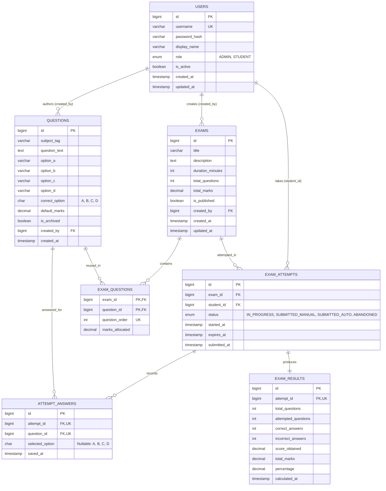

# Week 1 Architecture & Technical Specification
**Project:** Project 3 — Online Examination System  
**Stack:** Java (JDK 25/27), Java Swing (`CardLayout`, `javax.swing.Timer`), MySQL 8.x/9.x (InnoDB), HikariCP, JDBC, Argon2id (`argon2-jvm`), JUnit 6 & Mockito 5  

---

## 1. System Context & Architectural Overview

The Online Examination System is a layered desktop assessment application that separates presentation (Java Swing), business/timing rules (Service & Session layers), and persistence (JDBC DAO layer with HikariCP connection pooling).

### Layered Package Structure
```text
com.qveto.exam
├── config/       # HikariCP DataSource configuration & lifecycle management
├── model/        # Immutable domain records & enums (User, Exam, Question, ExamAttempt, ExamResult)
├── dao/          # Data Access Object interfaces
│   └── impl/     # PreparedStatement-based JDBC implementations
├── service/      # Core business logic, transaction boundaries, timer & grading rules
├── session/      # In-memory authenticated user context & RBAC gatekeeper
├── validation/   # Input sanitization & domain invariant validators
├── util/         # Argon2id password hashing, char[] memory wiping, seed utilities
└── ui/           # Swing CardLayout screens & javax.swing.Timer controllers
```

### Architectural Invariants
1. **Strict Separation of Concerns:** Swing UI components (`JPanel`, `JFrame`) never import `java.sql.*` or execute SQL queries. All UI actions invoke service methods.
2. **Answer Key Protection:** Student-facing DTOs and UI models never receive `Question.correctOption()` while an exam attempt is in `IN_PROGRESS` status.
3. **Database-Backed Authoritative Timing:** `javax.swing.Timer` provides visual feedback on the Event Dispatch Thread (EDT), while `exam_attempts.expires_at` in MySQL acts as the authoritative deadline for accepting or rejecting answer mutations.

---

## 2. Role-Based User Journeys

### 2.1 Administrator Journey
1. **Authentication:** Logs in via `AuthService.authenticate(username, char[])`. `SessionContext` verifies `Role.ADMIN`.
2. **Question Bank Management:**
   - Creates reusable multiple-choice questions (`subject_tag`, `question_text`, options `A`–`D`, `correct_option`, `default_marks`).
   - Edits existing questions or soft-deletes (`is_archived = TRUE`) questions already referenced by historical attempts so foreign key integrity in `exam_questions` and `attempt_answers` is preserved.
3. **Exam Creation & Publishing:**
   - Creates an exam shell (`title`, `description`, `duration_minutes`, `total_questions`, `total_marks`, `is_published = FALSE`).
   - Maps questions from the reusable Question Bank into `exam_questions` with explicit `question_order` and `marks_allocated`.
   - Publishes the exam (`is_published = TRUE`) only after validating that:
     - $\text{COUNT}(\text{exam\_questions.question\_id}) = \text{exams.total\_questions}$
     - $\sum \text{exam\_questions.marks\_allocated} = \text{exams.total\_marks}$
4. **Result & Completion Review:** Views all student attempts, completion states (`SUBMITTED_MANUAL`, `SUBMITTED_AUTO`, `ABANDONED`), and calculated scores across exams.

### 2.2 Student Journey
1. **Authentication & Profile:** Logs in as `Role.STUDENT`. Can update `display_name` and password via `UserDao.updateProfile()`.
2. **Dashboard & Discovery:** Views published exams (`is_published = TRUE`), exam rules/durations, and personal past attempt history.
3. **Timed Examination Flow:**
   - Starts an exam $\rightarrow$ system creates an `exam_attempts` row with `status = 'IN_PROGRESS'`, `started_at = UTC_TIMESTAMP()`, and `expires_at = started_at + INTERVAL duration_minutes MINUTE`.
   - Views one question at a time; navigating **Next** or **Previous** immediately upserts the current selection into `attempt_answers`.
4. **Submission & Immediate Grading:**
   - **Manual Submit:** Student confirms submission before `expires_at` $\rightarrow$ status transitions to `SUBMITTED_MANUAL`.
   - **Auto Submit:** Countdown reaches `00:00` (or server clock passes `expires_at`) $\rightarrow$ status transitions to `SUBMITTED_AUTO`.
   - **Result View:** System atomically computes and persists `exam_results` and displays score, percentage, and breakdown.

---

## 3. Entity-Relationship (ER) Diagram



### Schema Design Decisions
* **Question Bank Reuse (`exam_questions`):** Many-to-many join table with composite primary key `(exam_id, question_id)` and composite unique key `(exam_id, question_order)`. Allows any question in `questions` to be reused across multiple exams with custom per-exam `marks_allocated` without duplicating question rows.
* **Idempotent Answer Persistence (`attempt_answers`):** Unique constraint `uk_attempt_question (attempt_id, question_id)` enables atomic `INSERT ... ON DUPLICATE KEY UPDATE selected_option = VALUES(selected_option)` during Next/Previous navigation.
* **Immutable Results (`exam_results`):** `UNIQUE` constraint on `attempt_id` ensures an attempt can be graded and recorded exactly once.

---

## 4. Exam Attempt State Machine & Session Rules

```text
                    [Student clicks "Start Exam"]
                                  │
                                  ▼
                         ┌─────────────────┐
                         │   IN_PROGRESS   │◄────┐ (Upsert attempt_answers on
                         └────────┬────────┘─────┘  Next/Prev navigation while
                                  │                 UTC_TIMESTAMP() < expires_at)
            ┌─────────────────────┼─────────────────────┐
            │                     │                     │
  [Confirmed Manual]    [Timer hits 00:00 OR   [Unrecovered crash / forced
   before expires_at]    UTC_TIMESTAMP() >=     exit where expires_at has
            │            expires_at]            elapsed without submission]
            ▼                     ▼                     ▼
  ┌──────────────────┐  ┌──────────────────┐  ┌──────────────────┐
  │ SUBMITTED_MANUAL │  │  SUBMITTED_AUTO  │  │    ABANDONED     │
  └─────────┬────────┘  └─────────┬────────┘  └──────────────────┘
            │                     │
            └──────────┬──────────┘
                       ▼
        [Single Atomic JDBC Transaction:
         Compute & Insert immutable row
         into exam_results]
```

### Session & Interruption Rules
| Event / Scenario | System Behavior |
| :--- | :--- |
| **Next / Previous Navigation** | Persists current selection (`A`/`B`/`C`/`D` or `NULL` if cleared) to `attempt_answers` only if `status = 'IN_PROGRESS'` and `UTC_TIMESTAMP() < expires_at`. |
| **Manual Submission** | Prompts confirmation dialog showing count of answered vs. unanswered questions. On confirmation, updates `status = 'SUBMITTED_MANUAL'`, sets `submitted_at = UTC_TIMESTAMP()`, and generates `exam_results` in one transaction. |
| **Timer Expiry (`00:00`)** | `javax.swing.Timer` stops immediately, disables radio buttons/navigation controls, invokes `ExamAttemptService.autoSubmit(attemptId)`, sets `status = 'SUBMITTED_AUTO'`, and transitions UI to the Result screen. |
| **Late Save After Expiry** | If a save request arrives after `expires_at`, the backend rejects the answer update, triggers `SUBMITTED_AUTO` using already-persisted answers, and returns the finalized result. |
| **Logout / Window Close During Exam** | `WindowListener` intercepts close/logout and prompts confirmation. If confirmed, or if the student logs back in before `expires_at`, the attempt can be resumed from persisted `attempt_answers` with remaining time `expires_at - UTC_TIMESTAMP()`. |
| **Stale `IN_PROGRESS` Attempt on Login** | If a student logs in and has a prior `IN_PROGRESS` attempt whose `expires_at <= UTC_TIMESTAMP()`, the service automatically reconciles it to `SUBMITTED_AUTO` (if answers exist) or `ABANDONED` (if no answers exist) and calculates results from saved answers. |

---

## 5. Result Calculation Specification

All score and percentage computations execute inside a single JDBC transaction (`conn.setAutoCommit(false)`) using `java.math.BigDecimal` to avoid IEEE 754 floating-point rounding drift.

### Definitions
Let $Q$ be the ordered set of questions mapped to the exam in `exam_questions`, and $A$ be the student's saved responses in `attempt_answers`:
* **Total Questions ($N_{\text{total}}$):** $\lvert Q \rvert$ (`exams.total_questions`)
* **Attempted Questions ($N_{\text{attempted}}$):** Count of $q \in Q$ where `selected_option IS NOT NULL`
* **Correct Answers ($N_{\text{correct}}$):** Count of $q \in Q$ where $\text{selected\_option} = \text{questions.correct\_option}$
* **Incorrect Answers ($N_{\text{incorrect}}$):** $N_{\text{attempted}} - N_{\text{correct}}$ (unanswered questions are neither correct nor incorrect and carry $0.00$ penalty)
* **Score Obtained ($S_{\text{obtained}}$):**
  $$S_{\text{obtained}} = \sum_{q \in Q_{\text{correct}}} \text{marks\_allocated}(q)$$
* **Total Marks ($S_{\text{total}}$):**
  $$S_{\text{total}} = \sum_{q \in Q} \text{marks\_allocated}(q)$$
* **Percentage ($P$):**
  $$P = \text{round}\left(\frac{S_{\text{obtained}}}{S_{\text{total}}} \times 100, \, 2, \, \text{HALF\_UP}\right)$$

---

## 6. Security & Data Integrity Controls

1. **Password Hashing & Memory Hygiene:**
   - Passwords are accepted from Swing `JPasswordField.getPassword()` as `char[]` (never converted to `String`).
   - Hashed using **Argon2id** (`m=65536` KiB, `t=3` iterations, `p=2` parallelism).
   - `rawPassword` arrays are unconditionally zeroed out (`\0`) inside `finally` blocks on both hash and verify paths.
2. **SQL Injection Prevention:**
   - Every DAO query uses `java.sql.PreparedStatement` with bound `?` parameters and HikariCP `cachePrepStmts=true`.
3. **Role-Based Access Control (RBAC):**
   - `SessionContext.requireRole(Role.ADMIN)` guards all exam creation, question bank mutation, and admin reporting service methods.
   - `SessionContext.requireRole(Role.STUDENT)` and ownership checks (`attempt.studentId().equals(currentUser.id())`) guard all exam-taking and submission methods.
4. **Secret Management:**
   - `src/main/resources/db.properties` is excluded via `.gitignore`.